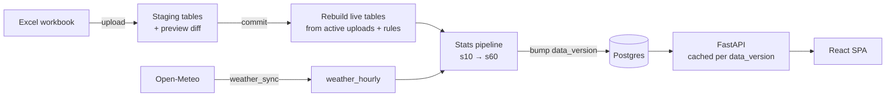
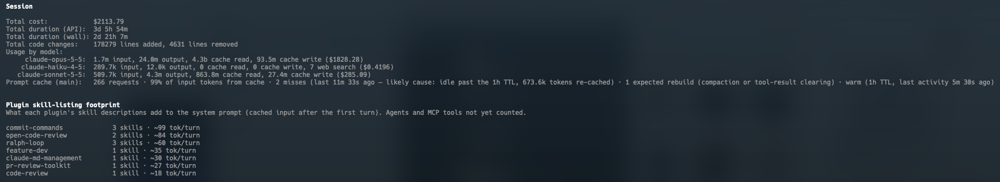

# Sunday Clays

**Every Sunday, 10 to noon, a group of shooters meets at Tri-County Gun Club in Sherwood, Oregon, to shoot 50
targets. For years the scores lived in two Excel workbooks. Now they live here:
[sundayclays.claysmasher.com](https://sundayclays.claysmasher.com).**

Sunday Clays turns six years of scoresheets into shooter profiles, personal bests, station difficulty, weather
effects, leaderboards that celebrate improvement, a trophy case, and hundreds of little "did you know" insights.
Each insight links to the chart that proves it. Upload the new workbook each week and everything updates.

It went from an empty repo to a live, self-hosted site in **four days**: September 27 to 30, 2026, 160+ pull
requests. We built it with [Claude Code](https://claude.com/claude-code) and a homelab full of local AI.

> The shooters in this repository have **invented names**. The scores, dates and weather are real, but every
> name in the test data, docs and examples was replaced before publishing. The live site uses the real names.

---

## What it does

- **Shooter profiles:** personal bests (overall, by season, weather and gauge), form and trends, a rating curve
  with its uncertainty band, a learning curve against the club, an attendance calendar, and a lifetime "odometer"
  (clays thrown, clays broken, streaks).
- **Stations:** hit rates per station with honest confidence intervals, how difficulty changes when the course
  is reset, which stations separate good days from great ones, and "where you lose targets".
- **Weather:** every Sunday's 10:00 to 12:00 conditions from Open-Meteo's historical archive (temperature, wind,
  gusts, rain, cloud). Rain against dry, cold against hot, wind by station, and each shooter's sensitivity,
  shrunk toward "no effect" so a few rainy Sundays can't tell a tall tale.
- **Skill model:** a small Kalman-filter rating that separates a shooter's skill from how hard the day was.
  Every Sunday gets a difficulty score, and every round gets an expected score. It powers "played above
  themselves", next-Sunday predictions and the improvement boards.
- **Leaderboards, the good-vibes way:** there is no "best shooter of all time" ranking. The boards call out who's
  improving, who shows up, who set a personal best, and a season points race you can replay as a bar-chart race.
- **Trophy Case:** 32 trophies (66 to collect once tiers are counted), from the tiered "Clays Broken" family (bronze through diamond) to Mudder (40+ in
  the rain) and Welcome Back. Tiered trophies show a progress bar toward the next tier.
- **Insights:** 74 kinds of precomputed facts ("first 45+ in over a year", "the club shot 2 targets better
  in the dry"). Every number in an insight is checked in CI against the chart it links to, and insights are
  recomputed only when the data changes.
- **Explorer:** pick any metric, group by anything, filter, and get a chart, a table and a CSV. Every chart has
  a plain-English "what this shows" explainer, a table view, CSV export and fullscreen.
- **Phone and desktop:** both are first-class, and every page is tested at both sizes.

## How it works



Five containers do the work: `db` (Postgres 17), `api` (FastAPI), `worker` (a job queue in Postgres), `caddy`
(serves the React build and proxies `/api`), and `backup`. Nothing is computed per request that could be computed
once per upload: the worker does the heavy lifting, and the API reads the results.

### Uploads and the rebuild

The club keeps its spreadsheets, and the site follows them.

- **Three kinds of workbook**, detected automatically (`backend/src/sunday_clays/ingest/`):
  - The **scores workbook** ("ALL SCORE DETAIL" plus "Attendance History"): one row per round, with status
    (member, guest) and gauge.
  - The **station workbook**: one tab per Sunday with hits per station. Totals are recomputed from the hits; the
    sheet's own SUM cells are never trusted.
  - A **special event** sheet for one-off Sundays with their own course and target count.
- **Preview first.** An upload is parsed into staging tables and diffed against what's live: new Sundays, changed
  rows, new shooters, possible duplicate names, station totals that don't match the score. Nothing changes until
  an admin commits. A scores upload that would remove rows needs an explicit confirmation.
- **Rebuild, never patch.** Committing (or rolling back) queues a `rebuild` job. It deletes every live table and
  rebuilds them from the active uploads, so the live data is always a pure function of the files. Every upload
  is kept, and any one can be rolled back.
- **Rules instead of edits.** Name fixes are durable rules layered on top of the source (`domain/rules.py`):
  merge, rename, alias, set status, score override, hide round, round type override, station reset. A rule that
  stops matching its target (say, the spreadsheet row was corrected) shows up as a data issue instead of silently
  applying to the wrong thing.
- **Weather** comes from Open-Meteo for the 10:00 to 12:00 window at the club. A daily `weather_sync` job fills in
  each Sunday after it happens (the archive API for anything a week old, the forecast API's recent past before
  that), and a separate job keeps next Sunday's forecast for predictions.

### The stats pipeline

After every rebuild (and after weather lands) the worker runs `run_pipeline` (`analytics/pipeline.py`). Steps are
discovered from `analytics/steps/` and run in order:

| Step | What it writes |
|---|---|
| `s10_metrics` | Per round: the field median that day, the adjusted score (score minus median), rank, best-round flag, percentile. Per Sunday: count, mean, median, spread, top score. |
| `s20_event_weather` | One weather row per Sunday, aggregated from the hourly data. |
| `s30_skill` | The skill model below: ratings, day difficulty, expected scores, rating history. |
| `s50_achievements` | Every trophy, recomputed from scratch. |
| `s60_insights` | Every insight, recomputed from scratch, plus the home page picks. |

The last thing it does is bump `data_version`. Every analytics read is memoised by `@cached_by_data_version`
(`analytics/cache.py`), so the cache invalidates itself the moment new data lands, and the worker warms the
popular pages right after.

Only regular 50-target Sundays feed the scoring stats. Special Sundays count as appearances (streaks, Sundays
held, shooters) but don't move ratings or averages. A Sunday counts as "held" when it has scores and at least
half of the head count turned in a score; incomplete Sundays are skipped by anything that compares a shooter to
the field.

## The stats engine

All of this lives in `backend/src/sunday_clays/analytics/`. It's pandas, NumPy and SciPy over a handful of
cached frames (`frames.py`).

### Skill model (`skill.py`)

Each score is modelled as **skill + how hard the day was + noise**. Every shooter carries a Kalman filter state:
a skill estimate and its variance.

- **Between Sundays**, uncertainty grows with time away (a small drift per week, capped), so a shooter back from
  six months off moves faster than a regular.
- **On a Sunday**, the day's difficulty is estimated from everyone who shot, weighted by how sure we are of each
  shooter. Each shooter is then judged against a leave-one-out version of the day, so their own score never sets
  the bar they're measured against. Two rounds on one Sunday count as a stronger observation than one.
- **Expected score** for a round is skill plus the day effect; the **residual** is what they shot minus that.
  Residuals power "played above themselves", form, rust after a layoff, and weather sensitivity.
- **Published scale.** Ratings are shifted by the average day over the last year, so a rating reads like "what
  you'd shoot on a typical recent Sunday". Difficulty is shown relative to that same typical day; positive means
  harder.
- **Calibration.** The noise, drift and day-spread parameters are picked by grid search, maximising the
  one-step-ahead likelihood of each Sunday's scores given everything before it.
- The profile's uncertainty band is the estimate ±1.96 standard deviations.

### Weather (`weather_effects.py`)

- **Club level:** a weighted regression of each Sunday's difficulty on temperature, gusts, rain and cloud cover.
- **Per shooter:** a regression of that shooter's residuals on the same conditions (10 rounds minimum). The
  results are then shrunk with empirical Bayes toward zero, so a shooter only gets a "wind sensitivity" when the
  data supports it. Effects are reported per 10 °F, per 10 mph of gust and per 0.1 in of rain.
- Plus band summaries: scores and difficulty by temperature, wind and rain band, and by season.

### Stations (`stations.py`)

- Hit rates come only from the station sheets.
- Confidence intervals are 95% Wilson intervals on an effective sample size. Hits by the same shooter in the same
  round aren't independent, so the sample is discounted by a design effect before the interval is drawn.
- **Course resets** are rules with a date; each reset starts a new era for that station, and pages can show the
  current layout or all of them.
- **Separator:** how strongly doing well at a station goes with doing well everywhere else that day.
- **Where you lose targets:** a shooter's hit rate at each station against the field's rate on the same Sundays,
  shrunk toward the field so one bad visit doesn't define a station.

### Leaderboards, records and the rest

- **Leaderboards** (`leaderboards.py`) cover the season (last 8 weeks), year to date, last 12 months and all time.
  Averages need a minimum number of rounds that scales with the window. "Most improved" needs enough rounds before
  and inside the window, and only lists people who gained.
- **Season points** (`points.py`): 10-8-6-5-4-3-2-1 for places one to eight on the best round, plus a point for
  showing up.
- **Personal bests** need five earlier rounds to beat. **Streaks** count consecutive held Sundays; a special
  Sunday extends the streak of anyone who came and doesn't break anyone else's.
- **Profiles** (`profile.py`): floor and ceiling (10th and 90th percentile of the last 20 rounds), form (mean
  residual of the last 5), rust after 4+ weeks away, and a learning curve against the club at the same career
  Sunday number.
- **Predictions** (`predictions.py`): who's likely to come (their share of the last 13 Sundays), each shooter's
  expected score, and the day's difficulty from the forecast and the club weather model.
- **Club pages:** milestones (`club_milestones.py`), core regulars and lapsed shooters, guest conversion, cohorts
  by first year (`cohorts.py`), and a year in review (`yir.py`).

### Explorer (`backend/src/sunday_clays/explorer/`)

One query shape: a metric (score, adjusted, rating, hit %, difficulty...), an aggregation, up to two group-bys
(shooter, month, season, gauge, weather band, station...) and filters. `run_query` builds one row per round,
station entry or Sunday and aggregates. The CSV download is built in the browser from the same rows.

### Insights (`analytics/insights/`)

Each of the 74 insight kinds is a small registered object: what it's about (a shooter, a Sunday, the club, a
station), an `evaluate` function that finds facts in the data, phrasing templates, the chart it links to, and the
checks that prove its numbers.

- **Safety at import time.** `register()` validates every kind, so a bad one fails CI rather than the site.
  Insights about a named shooter must be positive or neutral, and there must be a "you" version for the shooter's
  own page.
- **Lints on the template text** (`lints.py`): no gendered pronouns, no jargon (residual, percentile, median,
  correlation...), no head-to-head language (upset, rival, odds), and no negative words in any clause that names
  someone.
- **Proof in CI** (`proof.py`): for every insight, the test suite rebuilds the linked chart and reads the number
  back from it. If the headline says 42 and the chart says 41, the build fails.
- **No time travel.** Each Sunday's insights are computed from data up to that Sunday only.
- **Ranking** (`rank.py`) is care × strength × rarity × recency: rare facts beat common ones, and recent ones beat
  old ones. Pages then pick a few per family, so a profile doesn't show three streak facts at once.
- Wording is chosen from each kind's phrasings by a hash of the insight, so it doesn't change on every recompute.

### Trophies (`analytics/achievements/`)

32 achievements in six categories (milestone, calendar, conditions, scoring, stations, competition). Nine are
tiered, from bronze up to diamond, for 66 collectible trophies. Each one is either a value with thresholds (clays
broken, Sundays attended, best single round) awarded on the Sunday it was first reached, or a one-off check
(shot in the rain, sub-gauge round). They're recomputed from scratch on every pipeline run, so a rolled-back
upload takes its trophies with it.

### Weekly recap

An admin page (`/api/admin/recap/{date}`) builds a copy-and-paste recap for the club newsletter: turnout, up to
five "This week" lines, and milestones. It draws on the Sunday's insights plus recap-only facts
(`recap_facts.py`) and won't repeat a topic, person or sentence within 12 weeks.

## Running it

### Quick start

You need Docker, plus `uv` and `openssl` for the secrets script.

```sh
VIEWER_PASSWORD=viewer ADMIN_PASSWORD=admin scripts/dev-secrets.sh   # writes ./secrets/
docker compose up -d --build --wait                                  # http://localhost:8080
```

- Skip the two variables and `dev-secrets.sh` generates random passwords and prints them once. It never
  overwrites an existing file; delete `./secrets/` to start over.
- There are no user accounts. The site has two shared passwords, viewer and admin, stored as argon2id hashes.
  Log in with either. To hash a new one by hand: `uv run python -m sunday_clays.auth.hashpw` in `backend/`.
- Migrations run automatically when the `api` container starts.
- `compose.override.yaml` is picked up automatically for local runs: it publishes port 8080 and allows the
  session cookie over plain http.
- Stop with `docker compose down`; add `-v` to wipe the database and backups.

### Loading data

There's no seed command. Log in as admin, open **Imports** (`/admin`), upload a workbook, check the preview and
commit. The `worker` container has to be running, because the commit queues the rebuild and the stats pipeline.
Weather fills in on its own a little later.

The test fixtures make a quick starting point: `backend/tests/fixtures/scores_2026-09-27.xlsx`, then
`stations_2026-09-27.xlsx`. The Playwright setup uploads and commits these same two files, so an e2e run against
a fresh stack seeds it for you.

The same steps over the API: `POST /api/admin/imports` (multipart `file`), then
`POST /api/admin/imports/{id}/commit`, then poll `GET /api/admin/jobs/{job_id}`.

### Configuration

Settings come from environment variables (`backend/src/sunday_clays/config.py`). Each secret can be given
directly or as a `*_FILE` path, which is how compose passes `./secrets/`.

| Variable | Default | |
|---|---|---|
| `DATABASE_URL` | required | `postgresql+psycopg://...` |
| `SESSION_SECRET` | required | at least 32 bytes |
| `VIEWER_PASSWORD_HASH`, `ADMIN_PASSWORD_HASH` | required | argon2id hashes |
| `CLUB_LAT`, `CLUB_LON`, `TIMEZONE` | Tri-County Gun Club, `America/Los_Angeles` | where and when weather is fetched |
| `WEATHER_ENABLED` | `true` | turns off the Open-Meteo jobs |
| `FEATURES_DEFAULT_ON` | empty | comma-separated feature switches that start on (`weekly_recap`, `club_milestones`, `link_previews`...) |
| `COOKIE_SECURE` | `true` | the local override sets `false` |
| `PUBLIC_BASE_URL` | the live site | used in link previews and the recap |

Feature switches can also be flipped by an admin at runtime.

### Working on it without Docker

The frontend dev server proxies `/api` to `localhost:8000`:

```sh
cd frontend && pnpm install && pnpm dev
```

Running the backend outside Docker needs your own Postgres and the variables above (with `COOKIE_SECURE=false`):

```sh
cd backend
uv run alembic upgrade head
uv run uvicorn sunday_clays.api.app:create_app --factory --port 8000
uv run python -m sunday_clays.jobs.worker      # in another terminal
```

### Tests

| What | Where | Command |
|---|---|---|
| Backend | `backend/` | `uv run ruff check . && uv run mypy --strict src && uv run pytest` |
| Frontend | `frontend/` | `pnpm lint && pnpm typecheck && pnpm test` |
| End to end | `frontend/` | stack running, then `pnpm exec playwright install chromium && pnpm exec playwright test` |

- Backend tests start a throwaway Postgres container per run, so Docker has to be running. Point
  `TEST_DATABASE_URL` at an empty database to skip that.
- `pnpm typecheck` regenerates the API types from the backend's OpenAPI schema first, so it needs `uv` too.
- E2E logs in with `E2E_VIEWER_PASSWORD` and `E2E_ADMIN_PASSWORD`, which must match the passwords the stack was
  started with.
- CI also holds coverage at 99% and the JS bundle under its budget (`ratchets/`). The floors only ever go up.

See [`CONTRIBUTING.md`](CONTRIBUTING.md) for the full workflow, branch naming and hooks.

### Hosting

- **Images:** multi-arch (amd64 and arm64) images are published from green `main` commits.
- **Deploys:** the site runs as a Docker Swarm stack (`compose.yaml` plus `compose.swarm.yaml`). A small
  pull-based deployer on a Swarm manager watches `main`, mirrors each release into the local registry, then rolls
  the services one at a time with health checks, and rolls back on any failure. Merge a PR and the site updates
  itself a few minutes later.
- **Backups:** the `backup` container dumps and verifies the database every night at 02:30, keeps 14 dailies and
  8 weeklies, and the dumps go off-site with the rest of the homelab.

See [`deploy/README.md`](deploy/README.md) for the full runbook, including restores.

## Local AI in the loop

### Reading six months of paper scoresheets

The spreadsheets only have totals. Station-by-station detail existed only on the scanned scoresheet PDFs in
the club's weekly update emails. So we built [`tools/scoresheets`](tools/scoresheets/README.md), a
vision-model pipeline that reads them:

1. **Cut each scoresheet** into its six shooter blocks and read the course layout, including pictured courses
   and lettered stations like 7A.
2. **Read each block with a local vision model** served by Unsloth Studio. We started with **Qwen3-VL-30B-A3B**
   and settled on **Gemma 4 26B**, both running on our own hardware.
3. **Add a fast pass:** Claude (Opus) reads whole pages four at a time, and Gemma reads the same pages again
   locally as a second opinion.
4. **Trust the spreadsheet.** A shooter's station totals must add up **exactly** to the official spreadsheet
   score, or the reading doesn't count. Anything doubtful lands on a review page, where a human decides.
5. **Import the verified workbook** through the same upload screen as everything else.

That's 45 Sundays of station detail (October 2025 to September 2026) recovered from paper.

### Trophy art from a homelab GPU

Every trophy medallion, and every metal tier of it, was generated on **imagen**, our self-hosted image
generation service, using the Z-Image Turbo model. [`tools/trophy_art`](tools/trophy_art) submits one prompt per
trophy and metal with several seeds, builds a contact sheet, and a human picks the favourites. The picks are cut
into round medallions and committed as small WebP files. The site never calls an AI at runtime; the art is
static.

## How it was built

Claude Code wrote the code as a team of agents, with a human setting direction and making every judgment call:

- **Spec first.** An afternoon of brainstorming produced a design spec and a master plan, which was split into
  13 sub-plans with every task written test-first.
- **Subagent-driven development.** Each task went to a fresh implementer agent in its own git worktree and
  branch. Every task was then reviewed by a separate, more capable reviewer model for spec compliance and code
  quality. Fix rounds went back and forth until the reviewer approved, and a whole-plan review closed each plan.
- **Parallel lanes.** Up to four UI lanes and the backend work ran at once on disjoint files, merging through
  GitHub auto-merge as CI went green.
- **Owner rules as code.** Some decisions became hard constraints that every agent and reviewer checks:
  - Improvement over ranking.
  - Positive-only insights about named shooters.
  - Neutral pronouns in all app copy.
  - The spreadsheet score is authoritative.
  - One date filter per page.
- **CI as the gate.** One required check, `ci-ok`, passes only when everything below passes:
  - Ruff and strict mypy.
  - ESLint and TypeScript.
  - About 2,700 backend and 2,100 frontend tests, with coverage held around 99% on both sides.
  - Bundle-size budgets.
  - Multi-arch image builds.
  - A Swarm config policy check.
  - Playwright end-to-end tests at phone and desktop sizes.
  - A backup-restore check.

### What it cost



At pay-as-you-go API prices the whole build would have come to about **$2,100**:
- 178,000 lines added.
- About 2 days 21 hours of wall-clock time, and 3 days 5 hours of API time, because agents ran in parallel.
- Mostly Opus for planning and reviews, and Sonnet for implementation.

It ran on a Claude subscription instead, so the real cost was about **$50**: roughly one week's usage allowance.
The local models (Gemma, Qwen, Z-Image Turbo) ran on hardware we already had.

## Stack

| | |
|---|---|
| Backend | Python 3.13, FastAPI, SQLAlchemy 2, Alembic, Postgres 17, pandas, NumPy, SciPy |
| Frontend | React 19, Vite, TypeScript, TanStack Query, React Router, Tailwind v4, Apache ECharts |
| Data | Open-Meteo archive and forecast; the club's Excel workbooks (openpyxl) |
| Tests | pytest with real Postgres (testcontainers), Hypothesis, Vitest, Testing Library, MSW, Playwright |
| Hosting | Docker Swarm on a mixed Raspberry Pi and x86 homelab; Caddy behind Traefik; Cloudflare Tunnel |

---

Built for the Sunday Clays crew, with thanks to everyone who kept score all those years. Feedback and ideas
welcome.
